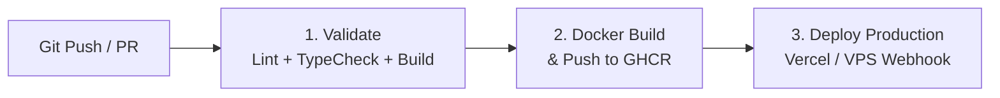

# 🍿 RẠP NHÀ - Nền Tảng Xem Phim Trực Tuyến & Phòng Xem Chung Realtime

Website xem phim trực tuyến hiện đại, chất lượng cao, tối ưu chuẩn Mobile First, tích hợp phòng xem chung realtime (Watch Party) và hệ thống Admin Dashboard quản trị toàn diện.

---

## 🚀 Tính Năng Nổi Bật

- **Kho phim phong phú:** Phim bộ, phim lẻ, phim hoạt hình, TV shows cập nhật liên tục từ API KKPhim với cache thông minh.
- **Trình phát HLS Video Player cao cấp:** Tự động lưu tiến độ xem dở, tiếp tục phát từ đoạn dừng trước đó, hỗ trợ chọn độ phân giải và chuyển tập mượt mà.
- **Phòng Xem Chung (Watch Party):** Đồng bộ trạng thái phát phim realtime giữa Host và các thành viên qua Supabase Realtime Channels.
- **Admin Dashboard chuyên nghiệp:**
  - Theo dõi người dùng Online thời gian thực (Supabase Realtime Presence).
  - Quản lý tài khoản, phân quyền quản trị viên (`admin` / `user`).
  - Biểu đồ lưu lượng truy cập (SVG Traffic Chart), phân bố thiết bị (Mobile / Desktop / Tablet).
  - Hệ thống tiếp nhận góp ý, báo lỗi phim và gửi email phản hồi trực tiếp qua Resend API.
- **Trải nghiệm Mobile First & Smooth Scrolling:**
  - Thanh điều hướng ngón tay cái (Mobile Bottom Navigation).
  - Vùng chạm tối thiểu $44 \times 44\text{px}$ chuẩn WCAG 2.1 AAA.
  - Tối ưu cuộn trang không giật lag, tự động khóa scroll nền khi mở modal và khôi phục nguyên vẹn khi đóng.

---

## 🛠️ Công Nghệ Sử Dụng

- **Frontend:** Next.js 16.3.8 (App Router & Turbopack), React 19, Tailwind CSS v4.
- **Backend & Database:** Supabase (PostgreSQL, Auth SSR, Realtime Presence).
- **Video Streaming:** HLS.js (HTTP Live Streaming).
- **Email Service:** Resend API.
- **CI/CD & Container:** GitHub Actions, Docker (Multi-stage Standalone Build), Docker Compose.
- **Testing:** Playwright Automation Testing (Mobile & Desktop E2E).

---

## 📦 Cài Đặt & Chạy Môi Trường Cục Bộ

### 1. Cài đặt dependencies
```bash
npm install
```

### 2. Cấu hình biến môi trường (`.env.local`)
Tạo file `.env.local` tại thư mục gốc với các biến sau:
```env
NEXT_PUBLIC_SUPABASE_URL=https://your-project.supabase.co
NEXT_PUBLIC_SUPABASE_ANON_KEY=your-supabase-anon-key

# Quản trị & Gửi email thông báo
FEEDBACK_RECEIVER_EMAIL=admin@example.com
RESEND_API_KEY=re_your_resend_api_key
FEEDBACK_SENDER_EMAIL="Rạp Nhà <onboarding@resend.dev>"
```

### 3. Chạy môi trường phát triển
```bash
npm run dev
```
Mở [http://localhost:3000](http://localhost:3000) trên trình duyệt để trải nghiệm.

### 4. Kiểm tra Type & Lint
```bash
npm run type-check   # Kiểm tra kiểu TypeScript (tsc --noEmit)
npm run lint         # Kiểm tra chuẩn mã nguồn ESLint
npm run test:scroll  # Chạy bài test tự động cuộn trang với Playwright
npm run build        # Build bản phát hành production
```

---

## 🐳 Triển Khai Với Docker & Docker Compose

Dự án đã được cấu hình sẵn **Multi-stage Dockerfile** tối ưu dung lượng (chỉ ~120MB sử dụng chế độ `output: "standalone"` của Next.js).

### Chạy bằng Docker Compose (Khuyên dùng):
```bash
# Khởi động dịch vụ ở chế độ background
docker compose up -d --build

# Xem logs hoạt động
docker compose logs -f

# Dừng dịch vụ
docker compose down
```

### Chạy trực tiếp bằng Docker:
```bash
# Build image
docker build -t rap-nha-web:latest .

# Run container
docker run -d -p 3000:3000 --env-file .env.local --name rap_nha rap-nha-web:latest
```

---

## 🔄 Luồng CI/CD Tự Động (GitHub Actions)

File cấu hình CI/CD hoàn chỉnh nằm tại: [`.github/workflows/ci.yml`](.github/workflows/ci.yml).

### Quy trình CI/CD gồm 3 giai đoạn:



1. **Giai đoạn 1: Quality Assurance (Validate)**
   - Kích hoạt khi có `push` hoặc `pull_request` vào nhánh `main`.
   - Tự động chạy `npm run type-check` (TypeScript).
   - Chạy `npm run lint` (ESLint).
   - Chạy `npm run build` để xác nhận bản dựng production không gặp lỗi.

2. **Giai đoạn 2: Docker Build & Container Registry**
   - Tự động build Docker Image bằng Docker Buildx với cache GitHub Actions.
   - Khi merge vào nhánh `main`, tự động push image lên **GitHub Container Registry (`ghcr.io`)** với các tag `:latest` và `:sha-xxxxxxx`.

3. **Giai đoạn 3: Continuous Deployment (CD)**
   - **Vercel Deployment:** Nếu cấu hình `VERCEL_TOKEN`, GitHub Actions sẽ tự động deploy trực tiếp lên Vercel Production.
   - **VPS / Server Webhook (Coolify, CapRover, Portainer):** Nếu cấu hình `DEPLOY_WEBHOOK_URL`, pipeline sẽ tự động gửi webhook gọi server kéo image mới nhất về và cập nhật không downtime.

---

## 🔑 Cấu Hình GitHub Secrets (Dành Cho CI/CD)

Để pipeline hoạt động đầy đủ tính năng CD, hãy vào **GitHub Repository -> Settings -> Secrets and variables -> Actions** và thêm các secret sau:

| Tên Secret | Bắt buộc | Mô tả |
|:---|:---:|:---|
| `NEXT_PUBLIC_SUPABASE_URL` | Không (Có fallback) | URL dự án Supabase của bạn |
| `NEXT_PUBLIC_SUPABASE_ANON_KEY` | Không (Có fallback) | Anon Key của Supabase |
| `RESEND_API_KEY` | Tùy chọn | API Key Resend để gửi mail thông báo |
| `FEEDBACK_RECEIVER_EMAIL` | Tùy chọn | Email admin nhận thông báo |
| `VERCEL_TOKEN` | Tùy chọn | Token cá nhân tạo từ Vercel Account Settings |
| `VERCEL_ORG_ID` | Tùy chọn | ID tổ chức trên Vercel |
| `VERCEL_PROJECT_ID` | Tùy chọn | ID dự án trên Vercel |
| `DEPLOY_WEBHOOK_URL` | Tùy chọn | Webhook URL để trigger triển khai trên VPS (Coolify/CapRover) |
